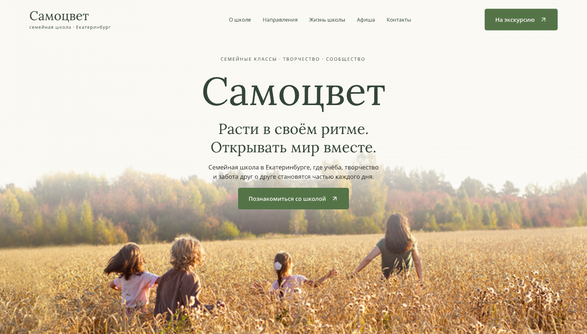
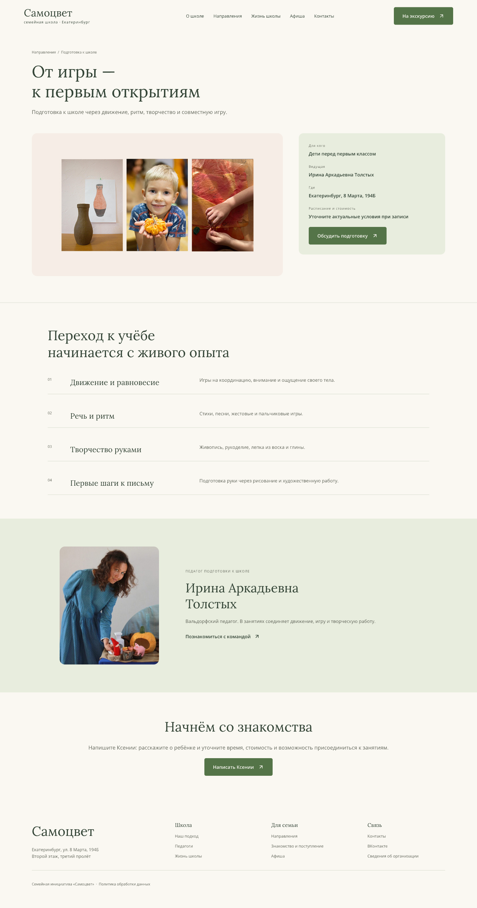
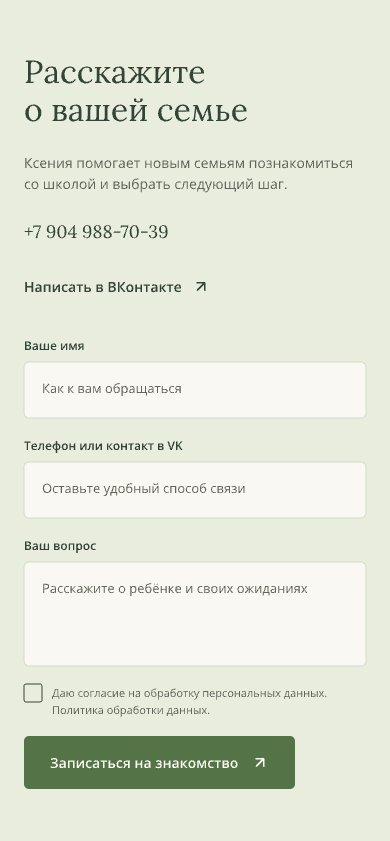
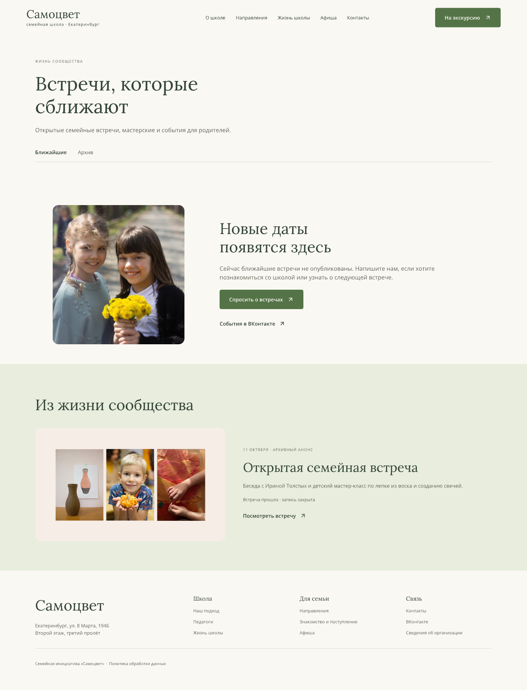

# Проверка макета Самоцвет

Дата исходной проверки: 13 октября 2026 года. Исходник: [samocvet.pen](../samocvet.pen). Ниже сохранены замечания и снимки версии до исправлений. Правки внесены через Pen MCP; исходник и HTML-превью обновлены.

## Исправление оформления по Fieldnote

13 октября 2026 года пользователь указал, что макет содержит слишком много добавленных приёмов оформления. Прежняя проверка удобства и размеров текста не была достаточной проверкой соответствия референсу. Пользователь уточнил: Fieldnote — основа дизайна, а не структуры сайта.

Сохранены 14 шаблонов страниц в двух размерах и 6 состояний — 34 экрана. На главной остаются девять прежних разделов в прежнем порядке: первый экран, подход, три принципа, четыре направления, жизнь школы, афиша, отзыв семьи, приглашение и подвал. Состав программ, педагогов, полей форм и ответов FAQ сохранён. Изменены оформление и компоновка внутри блоков.

Сверка выполнена по живым страницам [главной](https://lanternfish-perch-m9gg.squarespace.com/?password=preview), [направлений](https://lanternfish-perch-m9gg.squarespace.com/programs-overview), [педагогов](https://lanternfish-perch-m9gg.squarespace.com/meet-the-educators), [поступления](https://lanternfish-perch-m9gg.squarespace.com/enrollment-info) и [контактов](https://lanternfish-perch-m9gg.squarespace.com/contact). Часть блоков перенесена через браузер Pen как редактируемые слои в область «Референс · Fieldnote / исходные блоки».

| Шаг проверки | Изменение и источник оформления | Состояние и свежий снимок |
| --- | --- | --- |
| 1. Первый экран | Один заголовок и описание вместо крупного повторного названия, надзаголовка и второго слогана. Фото, центрирование и типографика главной Fieldnote; изображение школы сохранено | Компоновка целая: [компьютер](../design/review/2026-10-13/reference-correction/details/SBp2j.png), [телефон](../design/review/2026-10-13/reference-correction/details/h8V18.png) |
| 2. Принципы и направления | Три прежних принципа оформлены с графикой полосы ценностей референса. Убраны декоративная нумерация и стрелки. Фотоколонки направлений используют оформление Programs Overview без общей цветной карточки | Все четыре направления сохранены: [главная](../design/review/2026-10-13/reference-correction/after/IF7iB.png), [направления](../design/review/2026-10-13/reference-correction/after/dGso2.png) |
| 3. Педагоги | Вступление и чередующиеся строки «фото и биография» взяты за основу из Meet the Educators. Состав педагогов и тексты сохранены | Фоторяды целые: [снимок](../design/review/2026-10-13/reference-correction/details/ZgybO.png) |
| 4. FAQ | Заголовок слева, список справа, знаки раскрытия слева и тонкие линии — оформление Enrollment Info. Все шесть прежних ответов остаются раскрытыми в макете | Ответы читаются без обрезки: [снимок](../design/review/2026-10-13/reference-correction/details/ZyG9T.png) |
| 5. Формы | Светлый фон, зелёные поля и пунктирный контур взяты из Contact. Поля, согласие и состояние ошибки сохранены | Компоновка целая: [мобильная форма](../design/review/2026-10-13/reference-correction/details/J6rjJ.png), [контакты](../design/review/2026-10-13/reference-correction/after/yScO3.png) |
| 6. Кнопки и подвал | Lora в заголовках, Montserrat в основном тексте, Open Sans в кнопках. Зелёный `#678D58`, тёмный `#374036`, светлый `#DCEAD7`; кнопки без декоративных стрелок, контурные кнопки в приглашениях. Открытые колонки ссылок подвала оформлены по Fieldnote | Общие компоненты просмотрены: [подвал](../design/review/2026-10-13/reference-correction/details/koscY.png) |

Во всех 34 экранах Pen не обнаружил частично или полностью обрезанных элементов и элементов нулевого размера, в том числе после раскрытия экземпляров компонентов. Незавершённых фреймов и текста меньше 12 px нет. Сохранены снимки всех экранов; основные компоновки просмотрены визуально. Мобильный подвал дополнен теми же ссылками, которые показаны на компьютере, и оформлен по мобильному Fieldnote. Восемь HTML-превью и экспорты главной обновлены; мобильный HTML просмотрен в браузере Pen, пути изображений проверены. Это проверка статического макета; работа формы и клавиатуры проверяется при реализации сайта.

Снимки предыдущих проверок ниже сохраняют историческое состояние. Оценку «без ИИ-признаков» не следует выводить только из отсутствия технических ошибок: для неё нужна визуальная сверка конкретных блоков с референсом.

## Исправления 13 октября

| Замечание | Что изменено | Проверка результата |
| --- | --- | --- |
| Первый экран слишком рано уходит в атмосферный слоган | Под названием сразу названы семейные классы, подготовка к школе и продлёнка в Екатеринбурге, затем — практика, творчество и проекты | [Компьютер](../design/review/2026-10-13/fixed/SBp2j.png), [телефон](../design/review/2026-10-13/fixed/h8V18.png) |
| Не хватает подробных направлений | Добавлены семейные классы, продлёнка и индивидуальные занятия — по две версии. У семейных классов есть содержание, примеры проектов, участие родителей и порядок знакомства | [Семейные классы](../design/review/2026-10-13/fixed/GaICf.png), [продлёнка](../design/review/2026-10-13/fixed/U7aJh.png), [музыка и английский](../design/review/2026-10-13/fixed/PQpof.png) |
| FAQ почти целиком отправляет к личному обсуждению | Шесть ответов раскрывают семейные классы, подготовку, знакомство, участие родителей и оформление. Отдельно перечислены условия, которые нужно получить до решения | [Компьютер](../design/review/2026-10-13/fixed/ZyG9T.png), [телефон](../design/review/2026-10-13/fixed/A7u1y.png) |
| Мелкие подписи и согласие | Текст меньше 12 px увеличен во всех экранах. Согласие — 14 px, подписи полей — 14 px. Для флажков и кнопок меню показаны области 44 × 44 px | [Мобильная форма](../design/review/2026-10-13/fixed/J6rjJ.png) |
| Нет полного меню направлений и заметного перехода к педагогам | В шапке ссылка «Направления» отделена от кнопки раскрытия. Добавлены состояния списка на компьютере и внутри мобильного меню. На странице «О школе» появилась основная кнопка к педагогам | [Меню компьютера](../design/review/2026-10-13/fixed/V81EqS.png), [меню телефона](../design/review/2026-10-13/fixed/sJuKE.png), [о школе](../design/review/2026-10-13/fixed/CILk8.png) |

Теперь в Pen 34 экрана: 14 шаблонов страниц в двух размерах и 6 состояний. Проверены все фреймы: частично и полностью обрезанных элементов, нулевых размеров и незавершённых фреймов нет. Повторно просмотрены первые экраны, новые направления, FAQ, форма и оба раскрытых меню. Палитра, шрифты, фотографии и композиции Fieldnote сохранены.

Для ответов использованы [материалы ВК](vk-research.md) и [действующий сайт школы](https://samosvet-ekb.ru/), повторно прочитанный 13 октября. Это опубликованные сведения, ещё требующие согласования перед запуском. Текущие тарифы, классы и места, режим продлёнки, организация аттестации и обязанности родителей не добавлены предположением.

Карточка предстоящего события остаётся следующим шагом после получения подтверждённой полной даты и условий. В основной афише сохранены отсутствие новых дат и архив с закрытой записью. Год архивного анонса по-прежнему требует уточнения.

Клавиатурное открытие меню, Escape и возврат фокуса описаны в контексте элементов и [ТЗ](technical-spec.md#дизайн-и-адаптивность). Их работа, семантика, промежуточные ширины и отправка формы проверяются на реализованном сайте. Статические экспорты не отправляют обращения; экран подтверждения теперь явно обозначает пример.

## Повторная проверка исправлений

Исправленный `samocvet.pen` повторно просмотрен 13 октября 2026 года через Pen MCP. В 34 экранах не обнаружены частично или полностью обрезанные элементы, незавершённые фреймы, элементы нулевой ширины или текст меньше 12 px. У мобильной формы подписи полей и текст согласия имеют размер 14 px.

1. Первый экран теперь сразу называет семейные классы, подготовку и продлёнку. Изменение подтверждено свежим [снимком](../design/review/2026-10-13/verified/SBp2j.png).
2. У семейных классов есть подробная страница: формат, содержание, проекты, участие родителей и путь знакомства. Цена и аттестация остаются вопросами для школы.
3. Раскрытые меню показывают четыре направления. На компьютере название раздела и стрелка визуально разделены, на телефоне есть вложенный список: [компьютер](../design/review/2026-10-13/verified/V81EqS.png), [телефон](../design/review/2026-10-13/verified/sJuKE.png).
4. В FAQ шесть содержательных ответов, отдельно перечислены сведения для уточнения перед поступлением. Подтверждено свежим [мобильным снимком](../design/review/2026-10-13/verified/A7u1y.png).

Основные замечания учтены на уровне макета. Для афиши остаётся пример предстоящего события после подтверждения даты; работу меню, фокуса и отправки проверять при реализации. Эта повторная проверка не меняет исходник дизайна.

## Исходные замечания

## 1 Первый экран

Снимок: 01-first-screen.png. Визуальное состояние хорошее: единая палитра, настоящие фотографии, читаемый основной текст и заметная кнопка. Название и атмосферный слоган занимают главную позицию; предлагается раньше пояснить семейное обучение и назвать основные форматы. Пример для подзаголовка: «Семейные классы, подготовка к школе и продлёнка в Екатеринбурге. Учимся через практику, творчество и совместные проекты».

## 2 Выбор направления

Снимок: 02-program.png. Есть обзор четырёх форматов и подробная подготовка к школе с педагогом, содержанием и контактом. В списке фреймов не обнаружены отдельные подробные страницы семейных классов, продлёнки и индивидуальных занятий. Для показа основного предложения школы особенно полезна страница семейных классов. Цены и расписание не выдуманы, но перед реальным запуском их актуальность нужно подтвердить.

## 3 Обращение

Снимок: 03-mobile-inquiry.png. Понятная форма с именем, контактом и вопросом, рядом доступны Ксения и ВК. На странице знакомства есть три шага. FAQ пока не раскрывает условия: ответы о стоимости, аттестации и участии родителей направляют к личному обсуждению. Подтверждённые факты следует добавить до итоговой публикации. Декоративные подписи мобильной главной имеют размер 9–11 px; мелкий текст согласия и служебных ссылок требует проверки читаемости и увеличения. Размер активной зоны согласия, семантика, клавиатура и реальная отправка формы не проверены.

## 4 Афиша

Снимок: 04-events.png. Видны отсутствие новых дат, способ связаться, архивный анонс и обозначение закрытой записи. Это аккуратное состояние без выдуманных событий. Для коммерческого показа полезно дополнительно показать карточку предстоящего события после получения подтверждённой даты. Поведение переключения вкладок и обновление по времени в этом просмотре не проверялись.

## 5 Навигация

Для итогового сайта предлагается одно выпадающее меню — «Направления»: семейные классы, подготовка к школе, продлёнка, музыка и английский. Само название раздела открывает общую страницу с обзором форматов; отдельная кнопка со стрелкой раскрывает список. На телефоне этот список раскрывается внутри мобильного меню.

Остальные пункты остаются обычными ссылками. Статьи и события открываются со страниц «Жизнь школы» и «Афиша»; перечислять их в выпадающих меню не требуется. На странице «О школе» сделать заметную ссылку на педагогов.

В текущем макете можно сохранить обычную ссылку «Направления», пока подробные страницы остальных форматов не готовы. При подготовке полного меню добавить состояние раскрытого списка для компьютера и телефона, проверить открытие нажатием и управление с клавиатуры; раскрытие не должно зависеть только от наведения мыши.

Дополнительные снимки этой проверки перечислены в [реестре материалов](artifacts.md).

## Проверки и ограничения

Просмотрены ключевые desktop и mobile фреймы, дополнительные материалы команды, контактов и документов. В проверенных восьми основных фреймах Pen не сообщил частично или полностью обрезанных элементов. Это проверка макета, а не работающего сайта: адаптация на промежуточных ширинах, реальные переходы, отправка, фокус, озвучивание и соответствие требованиям доступности не подтверждены. Фотографии педагогов и актуальные роли требуют согласования со школой.

Приоритет: конкретный первый экран, подробные семейные классы, содержательные ответы родителям, читаемые мобильные подписи и меню направлений после подготовки вложенных страниц. Визуальное направление можно сохранить.
